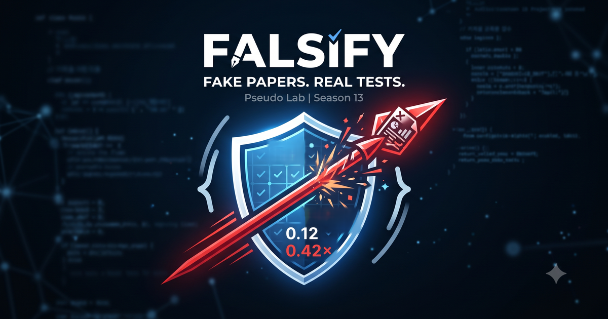

# Falsify



**가짜 논문을 만들고 잡는 검증 벤치마크**
부제: 창과 방패

> 논문에 그럴듯한 결함을 심어 검증기를 속이고, 그 공격을 잡는 게이트를 만듭니다.
> 뚫린 공격은 버리지 않고 그대로 공개 벤치마크가 됩니다.

가짜연구소(Pseudo Lab) 시즌 13 아카데미 프로젝트입니다.

---

## 러너 모집 안내

| 항목 | 내용 |
|---|---|
| 모집 | 2026년 9월 18일부터 9월 28일까지 |
| 선정 발표 | 2026년 10월 1일 |
| 활동 | 2026년 10월 4일부터 2027년 1월 9일까지 |
| 기간 | 12주 (중간 방학 2주 별도) |
| 정원 | 12명 |
| 모임 | 매주 월요일 밤 9시부터 11시까지, 온라인과 오프라인 교대 |
| 부담 | 주 2시간에서 3시간 |

지원은 [가짜연구소 프로젝트 페이지](https://pseudo-lab.com/projects/238d2cc5-cf2a-4d85-9a59-4af74160251b)에서 받습니다.

GitHub 기본 사용과 LLM 활용 경험이면 시작할 수 있습니다. **바이오 전공이나 시즌 12 참여 경험은 필요 없습니다.**

---

## 진행 방식

참가자는 두 역할을 번갈아 맡습니다.

**Red(공격)는 속입니다.** 미리 골라 둔 공개 논문에 그럴듯한 결함을 심어 검증기를 통과시킵니다.

**Blue(방어)는 잡습니다.** 그 공격을 걸러 내는 검증 규칙과 탐지기를 만듭니다.

한쪽이 뚫으면 그 사례가 데이터가 되고, 다른 쪽은 그 구멍을 막는 탐지기를 만듭니다. 시즌이 끝나면 **결함을 심은 논문과 탐지 결과를 짝지은 데이터셋과 리더보드**를 공개합니다.

### 다루는 결함 세 가지

| 코드 | 결함 | 무엇으로 판정하나 |
|---|---|---|
| D1 | 숫자 불일치 | 본문 서술값과 표의 값을 대조 |
| D2 | 없는 인용 | Crossref와 PubMed로 DOI, 저자, 연도를 조회 |
| D3 | 근거와 결론의 어긋남 | 결과가 결론을 실제로 지지하는지 판정 |

판정 라벨은 **맞음, 아님, 확인필요** 세 개입니다.

선택 트랙에서는 네 번째 결함 유형을 러너가 직접 제안할 수 있습니다. 유형만이 아니라 **그것을 잡을 탐지기 초안까지 함께** 내는 것이 조건입니다.

### 대상 논문

**생의학 오픈액세스(PMC Open Access)** 논문 10편에서 20편입니다. 기계로 판정할 근거가 이 범위에 모여 있어 골랐습니다.

- 인용이 실재하는지 PubMed와 Crossref로 조회할 수 있습니다
- 임상 논문은 1차 평가변수가 사전 등록돼 있어 결론과 맞댈 수 있습니다
- CC BY와 CC0 논문만 골라, 결함을 심은 변조판을 공개해도 라이선스가 막지 않습니다

---

## 시작한 이유

시즌 12 [AutoBioX](https://pseudo-lab.com/projects/ad2f2010-3ae1-4cf6-b231-a6d2ea5bb8ff)에서 AI 에이전트로 생물학 연구를 처음부터 끝까지 수행하는 파이프라인을 만들었습니다. 문헌을 읽고 가설을 세우고 분석을 실행해 원고와 그림까지 만드는 흐름을 실제로 세웠습니다.

그 과정에서 반복해서 마주한 문제가 있었습니다. **에이전트가 낸 결과가 맞는지 사람이 매번 다시 확인해야 했고, 검증 기준도 사람마다 달랐습니다.** 같은 결함을 두고 판정이 갈렸습니다.

이번 시즌은 그 지점에서 이어집니다. 논문을 쓰는 기계를 만들어 봤으니, 이번에는 그 결과물을 검사하는 쪽을 만들고 **그 검사기가 무엇을 못 잡는지까지** 재 보고자 합니다.

### 적대 구도를 고른 이유

결함을 판정하는 Blue는 어렵고 지루하지만, 속이는 Red는 진입장벽이 낮고 재밌습니다. 그리고 **속이기에 성공하면 그 사례가 그대로 데이터가 됩니다.** 놀다 보면 데이터셋이 쌓이는 구조입니다.

---

## 참여 대상

**필요한 것**

- GitHub 기본 사용 (clone, commit, PR)
- LLM 활용 경험 (Claude, ChatGPT, Gemini 중 아무거나)

**있으면 좋은 것**

- Python 기초
- 통계 기초 개념 (p값이 무엇을 뜻하는지 정도)
- 영어 초록을 번역기 도움으로 읽는 수준

**필요 없는 것**

- 바이오 전공. 결함 세 가지 중 둘은 도메인 지식 없이 다룹니다. 숫자 불일치는 본문의 값과 표의 값을 대조하면 되고, 없는 인용은 조회하면 됩니다
- 논문 정독. 논문마다 **사실 카드**(수치표, 인용 목록, 결론 문장)를 미리 만들어 드립니다. 원문 전체를 읽지 않아도 됩니다
- 시즌 12 참여 경험

엔지니어링이나 자연어처리 경험은 게이트를 만드는 데 도움이 됩니다.

---

## 운영 원칙 세 가지

**1. 경로 먼저.** 1주차에 저장소와 제출 양식, 자동 판정 실행을 먼저 세우고 게이트는 그 위에 올립니다. 만든 게이트가 실제 제출과 판정이 지나가는 길 위에 놓이게 합니다.

**2. 정답지 두 벌.** Red가 심은 결함도 검수 대상입니다. 라벨이 잘못되면 검증기의 성능도 정확히 평가할 수 없습니다.

**3. 범위 고정.** 논문 10편에서 20편, 결함 3종, 라벨 3개, 저장소 하나에 리포트 한 편. 이만큼만 하고 더 벌리지 않습니다.

---

## 선택 트랙

공통 활동(코어)은 모든 참가자가 함께합니다. **7주차부터 코어와 병행할 선택 트랙**을 관심에 따라 하나 고를 수 있습니다. 코어만 참여해도 완주할 수 있습니다.

| 트랙 | 내용 |
|---|---|
| T1 Red 자동화 | 결함을 심고, 게이트가 잡는지 보고, 막히면 다시 시도하는 순환을 만듭니다. 7주차는 손으로 시작하고 8주차부터 제공된 코드 틀을 활용해 자동화합니다. 프레임워크 경험은 필요 없습니다 |
| T2 근거 대조 | 인용한 논문의 원문이 해당 주장을 뒷받침하는지 대조합니다 |
| T3 표와 그림 판독 | PDF 표에서 수치를 뽑아 본문 서술과 대조합니다 |
| T4 새 결함 유형 | 네 번째 결함 유형과 그 탐지기를 함께 제안합니다 |
| T5 도메인 확장 | 생의학 밖 논문으로 코퍼스를 넓힙니다 |

---

## 12주 계획

| 주차 | 내용 |
|---|---|
| W1 | 킥오프와 제출 경로 구축. 저장소, 제출 양식, 자동 판정을 먼저 세웁니다 |
| W2 | 검증 기초와 코퍼스 확정. 사실검증과 변이 주입(mutation) 두 단계 개념, 논문과 사실 카드 확인, 결함 3종과 라벨 3개 합의 |
| W3 | Red 라운드 1. 숫자 불일치 심기와 상호 검수 |
| W4 | Blue 판정 1. 게이트로 판정하고 뚫림과 잡힘을 기록 |
| W5 | Red 라운드 2. 없는 인용 심기 |
| W6 | Blue 판정 2와 강화 루프 1. 뚫린 공격을 케이스로 등록하고 탐지기 보강 |
| W7 | 중간 벤치마크 공개. 여기서부터 선택 트랙을 코어와 병행합니다 |
| W8 | Red 라운드 3. 근거와 결론의 어긋남 심기 |
| W9 | Blue 판정 3과 강화 루프 2. 사람 판정과 모델 판정 비교 |
| W10 | 자유 공격 라운드. 결함 유형을 조합한 공격, 모델 간 판정 비교 |
| W11 | 데이터셋 정리와 리더보드 구축. 라이선스 점검과 재현 스크립트 |
| W12 | 최종 리포트와 공개 공유회 |

**빌더가 대상 논문과 사실 카드를 미리 만들어 둡니다.** 러너는 수집이 아니라 확인과 합의부터 시작합니다.

## 저장소 구조 (계획)

킥오프 1주차에 세웁니다.

```
falsify/
├─ corpus/          대상 논문, 사실 카드, 변조판
├─ submissions/     러너 제출물 (주차별)
├─ gates/           D1, D2, D3 탐지기
├─ eval/            판정 집계, 플립 측정, 정답지 두 벌 절차
├─ tracks/          선택 트랙
└─ .github/         제출 자동 판정
```

시즌 12에서 만든 검증 하네스를 시작 재료로 제공할 예정입니다. **러너가 0에서 시작하지 않습니다.** 공개 범위는 팀 합의 후 확정합니다.

---

## ⚠️ 변조판 취급 규약

이 저장소는 **결함을 일부러 심은 논문**을 담습니다. 그대로 흘러나가면 그 자체가 오염원이 되므로 다음을 지킵니다.

1. 변조판 파일마다 머리에 **기계가 읽을 수 있는 변조 표식**과 원문 DOI를 적습니다
2. 정상판과 변조판을 **디렉터리로 분리**하고, README와 `robots.txt`에 크롤링 금지를 명시합니다
3. 변조 내역을 **원문 대비 diff로 함께 배포**해, 누구나 무엇을 바꿨는지 확인하고 원문과 대조할 수 있게 합니다

**이 저장소의 변조판을 학습 데이터나 근거로 쓰지 마십시오.** 검증기의 성능과 한계를 평가하기 위한 자료입니다.

---

## 기여

시즌 중에는 러너 제출이 중심이지만, 외부 기여도 환영합니다.

- **새 공격 제출 (Red)**: 결함을 심은 사례와 그것이 왜 그럴듯한지
- **새 게이트 제출 (Blue)**: 탐지기와 그것이 잡는 결함 유형, 그리고 못 잡는 것

리뷰는 **작성자와 검수자를 분리**합니다. 자기가 낸 것을 자기가 통과시키지 않습니다.

Issue와 PR 템플릿은 킥오프 때 올립니다.

---

## 라이선스

- 코드: MIT (예정)
- 데이터셋: CC BY-NC (예정)

원문 논문은 각 논문의 라이선스를 따릅니다. PMC Open Access의 CC BY 또는 CC0 논문만 씁니다.

**팀 합의 후 확정합니다.**

---

## In English

**Falsify** is a red team versus blue team benchmark for scientific paper verification, run as a Pseudo Lab Season 13 project.

Participants plant plausible defects into open access biomedical papers and try to slip them past verification gates. Others build detectors to catch them. Successful attacks are not discarded. They become the benchmark.

Three defect types: numeric inconsistency between text and tables, fabricated citations, and claims unsupported by the reported evidence. Three labels: correct, incorrect, needs review.

At the end of the season we release the paired corpus of planted defects and detection results, plus a leaderboard.

We draw the corpus from the PMC Open Access subset, using only CC BY or CC0 papers so that modified versions can be redistributed legally. Citations are checked against Crossref and PubMed, and where a trial is registered, its pre-specified primary outcome anchors the conclusion check.

---

## 관련

- [가짜연구소 (Pseudo Lab)](https://pseudo-lab.com)
- [시즌 12 AutoBioX](https://pseudo-lab.com/projects/ad2f2010-3ae1-4cf6-b231-a6d2ea5bb8ff) (AI 에이전트 연구 파이프라인)

문의는 Issue로 남겨 주세요.

## Workbench 제안 도구 (이 브랜치)

러너가 구현한 논문 실험용 웹앱과 HTML 사용설명서를 [tools/workbench](tools/workbench)에 담았습니다.
기존 프로젝트 소개·계획·평가 기준을 변경하지 않는 제안 도구이며, 팀 승인 또는 공식 벤치마크 검증을 뜻하지 않습니다.

- [웹앱 바로 열기](https://shinick-han.github.io/falsify-branch-preview/) · [온라인 사용설명서](https://shinick-han.github.io/falsify-branch-preview/guide.html)
- 위 링크는 러너 개인 계정에 배포한 이 브랜치의 미리보기이며 팀 공식 사이트가 아닙니다. 외부 AI 답변 가져오기·브라우저 PDF 편집은 PC 연결 없이 사용합니다. 로컬 CLI로 모델을 실행할 때 companion을 연결합니다. 기존 개인 Workbench와 같은 도메인이라 브라우저 기록·Harness 저장소를 공유합니다. 분리하려면 별도 브라우저 프로필을 쓰세요.

- [HTML 사용설명서](tools/workbench/app/dist/guide.html): 간단한 사용법을 먼저, 설치·RED·BLUE·검수·Harness·오류 해결을 뒤에 설명합니다. GitHub 화면은 HTML 소스를 표시하므로 파일을 내려받아 브라우저로 열어 주세요.
- [실행·소스 안내](tools/workbench/TEAM-INTEGRATION.md): 브랜치 내려받기, 폴더 위치, 로컬 실행과 코드 출처.

Workbench 원래 코드의 AGPL-3.0-only 및 외부 구성요소 고지를 해당 폴더에 유지했습니다.
논문 원본·변조판·정답·비공개 Harness·실험 기록·녹음·로그인 정보·개인 PC 설정은 포함하지 않았습니다.
