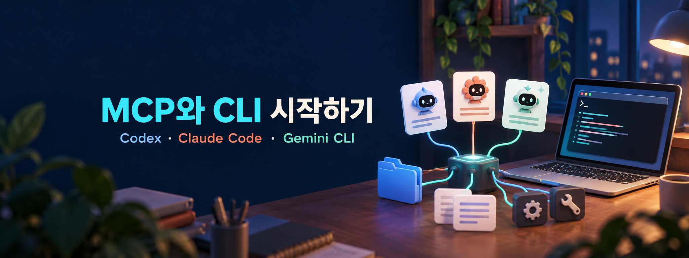
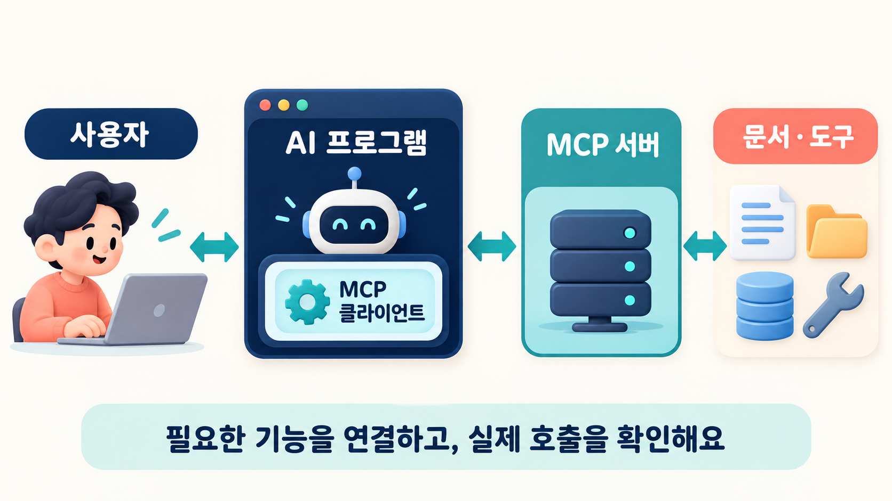
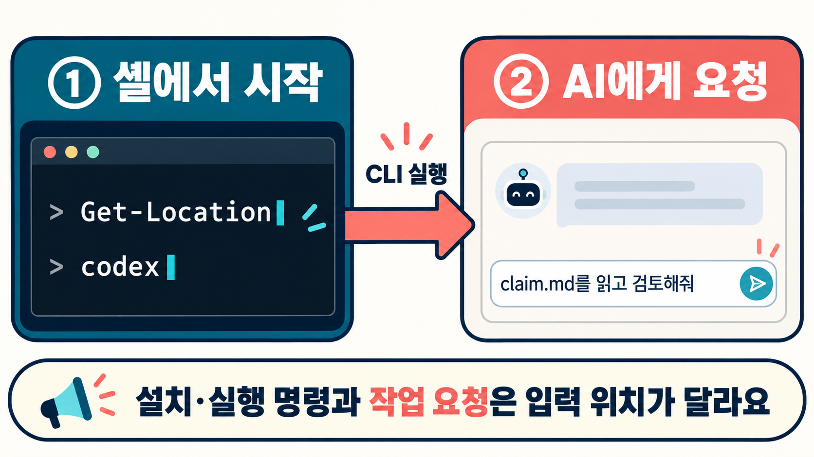
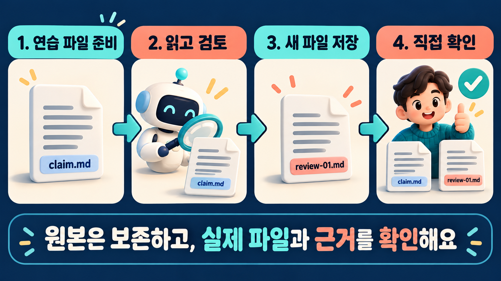

# MCP와 CLI 시작하기 — AI를 내 작업 환경으로



> 작성: 이건규 · 게시: 2026-10-19 · [가짜연구소 원문](https://pseudo-lab.com/blog/8653d89c-9470-4d31-bcc4-9a8bea6df221)

에이전트에게 역할을 주고, 스킬로 작업 요령을 정리하고, 하네스로 실행과 기록을 관리해봤다면 다음에는 **내 폴더의 파일을 읽고 실제 작업을 해보는 단계**로 넘어갈 수 있습니다.

이번 글은 MCP의 뜻부터 터미널의 기본, Codex CLI·Claude Code·Gemini CLI의 설치와 첫 실행까지 한 번에 모은 입문 안내입니다. 처음부터 세 도구를 모두 설치할 필요는 없습니다. 사용할 수 있는 계정이 있는 도구 하나를 골라 따라 해보세요.

> 명령·공식 문서 확인: **2026-10-19**. 계정·요금제·조직 정책과 설치 버전에 따라 화면이나 이용 조건이 다를 수 있습니다. 이 글을 작성하면서 독자의 컴퓨터에 프로그램을 설치하거나 계정 로그인·MCP 연결을 실행한 것은 아닙니다.

## 이 글을 따라가는 순서

1. MCP와 CLI가 무엇인지 이해합니다.
2. 터미널에서 현재 폴더와 명령 입력 방법을 익힙니다.
3. 작은 연습 파일을 준비합니다.
4. CLI 하나를 선택해 설치·로그인합니다.
5. 파일을 읽고 결과를 저장하는 첫 작업을 해봅니다.
6. 필요하면 MCP 문서 서버를 연결합니다.
7. 입력·실행 조건·결과를 기록하고 공유합니다.

## 1. MCP란 무엇인가요?

**MCP(Model Context Protocol)는 AI 프로그램과 외부 도구·자료 제공 기능을 연결하는 표준 통신 규약입니다.** 예를 들어 AI가 문서 검색이나 업무 도구의 기능을 사용하도록 연결할 때 활용할 수 있습니다.

‘AI용 공통 연결 규격’ 정도로 생각하면 편합니다. 다만 MCP 하나를 설치하면 모든 서비스가 자동 연결되는 것은 아닙니다.

| 구성 | 쉬운 뜻 | 예시 |
| --- | --- | --- |
| 호스트 | AI 기능과 연결을 운영하는 프로그램 | MCP를 지원하는 CLI나 앱 |
| 클라이언트 | 호스트 안에서 서버와 통신하는 구성 | 특정 서버에 연결하는 부분 |
| 서버 | 도구나 자료를 MCP 방식으로 제공하는 구성 | 문서 검색 서버 |

서버는 제공 기능에 따라 도구(tools), 자료(resources), 프롬프트(prompts) 등을 노출할 수 있습니다. ‘서버’가 반드시 원격 컴퓨터라는 뜻은 아닙니다. 내 컴퓨터에서 실행하는 프로그램일 수도 있습니다. [MCP 공식 구조 설명](https://modelcontextprotocol.io/docs/learn/architecture)

```text
사람의 요청
    ↓
AI를 사용하는 프로그램
    ↓ 내부 MCP 클라이언트
MCP 서버
    ↓
서버가 제공하는 문서·도구·서비스
```



*그림 1. MCP 구조를 이해하기 위한 개념도입니다. 연결 기능과 접근 권한은 따로 확인합니다.*

### 스킬과 MCP는 무엇이 다른가요?

| 개념 | 하는 일 | 예시 |
| --- | --- | --- |
| 스킬 | 어떤 절차로 일할지 알려줌 | 문서를 찾고 원문을 확인한 뒤 근거와 함께 답하기 |
| MCP | 외부 기능과 통신할 연결 방식을 제공 | 문서 검색 도구에 연결 |
| 하네스 | 실행·도구·상태·기록 등을 관리 | 연결한 도구를 사용할 수 있게 하고 실행 결과 보관 |

스킬에 ‘문서를 검색하라’고 적어도 실제 검색 기능이 연결되지 않았다면 검색할 수 없습니다. 반대로 도구가 연결되어 있어도 언제 어떤 순서로 사용할지는 작업 지시가 필요합니다.

### MCP가 꼭 필요한가요?

처음에는 필요하지 않습니다. CLI의 기본 파일 읽기·편집 기능만으로도 연습할 수 있습니다. 외부 자료나 특정 서비스 기능이 필요할 때 연결을 더하면 됩니다.

MCP 연결과 서비스 접근 권한도 별개입니다. 업무 서비스라면 로그인이나 권한 부여가 필요할 수 있고, 연결되었다고 모든 자료를 볼 수 있는 것은 아닙니다.

## 2. CLI와 터미널이란 무엇인가요?

**CLI(Command Line Interface)는 글자로 명령을 입력해 프로그램을 사용하는 방식**입니다. 터미널은 그 명령과 결과를 보여주는 창이고, PowerShell·Bash 같은 셸은 명령을 해석하는 프로그램입니다.

```text
터미널 창 → 셸에서 명령 입력 → CLI 실행 → AI에게 작업 요청
```

예를 들어 PowerShell에서 `codex`를 입력하면 Codex CLI가 시작됩니다. 그다음 AI 입력 화면에서는 자연어로 작업을 부탁합니다.

### 가장 중요한 구분: 지금 어디에 입력하고 있나요?

| 입력 위치 | 넣을 내용 | 예시 |
| --- | --- | --- |
| PowerShell·셸 | 프로그램 실행·폴더 이동 명령 | `codex`, `claude`, `gemini`, `Get-Location` |
| 실행된 AI 입력 화면 | 자연어 요청과 제품 내 명령 | “claim.md를 읽어줘”, `/help` |

`npm install ...` 같은 설치 명령을 AI 입력창에 붙여 넣는 것과 직접 셸에서 실행하는 것은 다릅니다. 아래에서는 각 코드 블록의 입력 위치를 표시합니다. 한 도구를 종료한 뒤 셸로 돌아와 다음 명령을 실행하세요.



*그림 2. 입력 위치를 구분하는 개념 예시입니다. 실제 제품 화면을 캡처한 이미지는 아닙니다.*

## 3. 준비: 연습 폴더와 파일 만들기

### Windows: PowerShell 열기

시작 메뉴에서 `PowerShell` 또는 `터미널`을 검색해 엽니다. 이 글은 Windows PowerShell 명령을 기준으로 설명합니다. 회사 관리 PC라면 설치와 로그인은 조직 지침을 따르세요.

현재 위치를 확인합니다. **PowerShell에 입력합니다.**

```powershell
Get-Location
```

처음에는 중요한 프로젝트 대신 연습 폴더를 사용하세요. 아래는 사용자 폴더 안에 `ai-cli-lab`을 새로 만드는 예시입니다. 같은 폴더가 이미 있다면 다른 이름을 사용하거나 기존 내용을 먼저 확인합니다.

```powershell
$practicePath = Join-Path $env:USERPROFILE 'ai-cli-lab'
New-Item -ItemType Directory -Path $practicePath
Set-Location -LiteralPath $practicePath
Get-Location
```

자주 쓰는 명령은 이 정도면 시작할 수 있습니다.

| PowerShell 명령 | 뜻 |
| --- | --- |
| `Get-Location` | 현재 폴더 확인 |
| `Get-ChildItem` | 파일·폴더 목록 확인 |
| `Set-Location -LiteralPath '폴더경로'` | 해당 폴더로 이동 |
| `Get-Content -LiteralPath '.\claim.md'` | 파일 내용 확인 |

### 공통 연습 파일

메모장에서 새 파일을 만들고 아래 내용을 연습 폴더의 `claim.md`로 저장하세요. 파일 이름이 `claim.md.txt`가 아닌지 확인합니다.

```markdown
# 검토할 주장

사례 ID: DEMO-01

주장: 계획한 10명 전원에게 결과를 제공했다.

근거 E01: 계획한 10명 중 8명에게 결과를 제공했고 2명은 보류했다.
```

**기대 판정은 ‘아님’입니다.** 이것은 사람이 결과를 확인할 때 사용할 연습용 기대값입니다. 먼저 파일과 근거만 AI에게 주고 비교해 보세요.

### macOS·Linux에서는

터미널 앱을 열고 아래처럼 연습 폴더로 이동합니다. 이 블록은 PowerShell용이 아닙니다.

```bash
mkdir -p ~/ai-cli-lab
cd ~/ai-cli-lab
pwd
ls
```

같은 내용의 `claim.md`를 텍스트 편집기로 저장하면 이후 자연어 실습은 동일하게 진행할 수 있습니다.

## 4. 설치 전: 계정과 Node.js 확인

**설치 성공과 AI 사용 가능은 별개입니다.** 로그인 방법, 이용 한도, 조직 설정을 확인해야 합니다. 구독 계정 로그인과 API 자격 증명 사용은 과금 경로가 같다고 가정하지 마세요.

| 도구 | 이 글의 로그인 시작점 | 확인할 점 |
| --- | --- | --- |
| Codex CLI | 실행 후 ChatGPT 로그인 등 제공 옵션 | 계정의 Codex 이용 조건과 선택한 인증 방식 |
| Claude Code | 지원 구독 또는 Console 등 로그인 | 무료 Claude 계정만으로 가능한 것으로 가정하지 않기 |
| Gemini CLI | Google 계정 로그인 | 개인·조직 계정에 따른 추가 설정 |

인증의 근거는 각 도구의 아래 설치·로그인 절에 연결했습니다. API 키는 이 실습의 필수 준비물이 아닙니다.

### npm으로 설치할 경우

이 글은 Codex CLI와 Gemini CLI에 npm 설치 예시를 사용합니다. **[Node.js 공식 다운로드](https://nodejs.org/en/download)**에서 LTS 버전을 설치한 뒤 터미널을 새로 여세요. Gemini CLI 공식 문서는 Node.js 20 이상을 요구하므로 오래된 Node.js를 사용하지 않습니다. [Gemini CLI 설치 조건](https://geminicli.com/docs/get-started/installation/)

PowerShell에서 확인합니다.

```powershell
node --version
npm.cmd --version
```

Windows 예시는 `npm.cmd`를 사용합니다. macOS·Linux에서는 `npm`을 사용하세요. 버전 번호가 나오면 다음으로 갑니다. 명령을 찾지 못하면 설치나 PATH를 먼저 확인합니다.

## 5. Codex CLI 시작하기

Codex CLI는 터미널에서 로컬 프로젝트를 읽고 수정하거나 도구를 실행하며 작업하는 인터페이스입니다. 아래는 npm 설치 경로입니다. 별도 설치 방식을 선호하면 공식 CLI 안내의 운영체제별 옵션을 사용하세요. [Codex CLI 공식 안내](https://learn.chatgpt.com/docs/codex/cli), [공식 npm 배포 기록](https://learn.chatgpt.com/docs/changelog)

### ① 설치 — PowerShell

```powershell
npm.cmd install -g @openai/codex
```

macOS·Linux에서는 다음을 사용합니다.

```bash
npm install -g @openai/codex
```

설치가 끝나면 새 터미널에서 확인합니다.

```text
codex --version
```

### ② 연습 폴더에서 실행·로그인

연습 폴더에 있는지 확인한 뒤 **셸에서** 실행합니다.

```text
codex
```

첫 실행에서 제공되는 ChatGPT 로그인 등 인증 방법을 선택하고 안내를 따릅니다. 작업 폴더나 권한을 확인하는 화면이 나오면 내가 준비한 연습 폴더가 맞는지 봅니다. [실행과 로그인 안내](https://learn.chatgpt.com/docs/codex/cli)

### ③ 첫 요청 — Codex 입력 화면

```text
현재 작업 폴더의 claim.md를 읽어줘.
파일은 수정하지 말고, 제공된 근거만으로 주장을 검토해줘.
판정은 맞음 / 아님 / 확인 필요 중 하나로 적고,
실제로 읽은 파일과 근거 ID, 짧은 원문 인용, 이유와 최소 수정안을 제시해줘.
파일을 읽지 못했다면 그 사실과 필요한 입력을 알려줘.
```

읽기와 판단을 먼저 확인합니다. 파일을 실제로 열었는지, E01을 인용했는지도 봅니다. 다음 단계의 결과 저장은 세 도구 공통 실습에서 진행합니다.

### ④ 종료·다시 이어가기

작업이 끝난 Codex 화면에서 `/quit` 또는 `/exit`로 종료합니다. 나중에 셸에서 `codex resume`를 실행해 저장된 대화를 선택할 수 있습니다. 종료가 파일 변경을 자동으로 되돌리지는 않습니다. [Codex 명령 안내](https://learn.chatgpt.com/docs/developer-commands)

## 6. Claude Code 시작하기

여기서 말하는 Claude의 CLI 도구 이름은 **Claude Code**이고, 시작 명령은 `claude`입니다.

### ① 설치 — Windows PowerShell

아래는 공식 문서의 Windows 설치 명령입니다. 공식 설치 스크립트를 내려받아 실행합니다.

```powershell
irm https://claude.ai/install.ps1 | iex
```

macOS·Linux·WSL에서는 다음 공식 명령을 사용합니다.

```bash
curl -fsSL https://claude.ai/install.sh | bash
```

설치 후 새 터미널을 열어 확인합니다.

```text
claude --version
```

Windows 설치와 셸 구성은 공식 안내를 참고하세요. [Claude Code 설치 안내](https://code.claude.com/docs/en/setup)

### ② 연습 폴더에서 실행·로그인

**셸에서** 실행합니다.

```text
claude
```

첫 실행의 로그인 안내를 따릅니다. 공식 문서에는 지원 구독(Pro·Max·Team·Enterprise), Console 등의 인증 경로가 안내되어 있습니다. 계정과 선택한 경로의 이용 조건을 확인하세요. [Claude Code 빠른 시작](https://code.claude.com/docs/en/quickstart)

### ③ 같은 파일로 첫 요청

Codex 절의 ‘첫 요청’을 그대로 Claude Code 입력 화면에 넣어보세요. 읽은 파일과 근거를 확인한 뒤 결과를 비교하면 됩니다. 원문 파일을 유지한 상태에서 하나씩 실행합니다.

### ④ 도움말·종료·재개

| 입력 위치 | 명령 | 용도 |
| --- | --- | --- |
| Claude Code 안 | `/help` | 도움말 |
| Claude Code 안 | `/exit` | 종료 |
| 셸 | `claude -c` | 현재 폴더의 최근 대화 이어가기 |
| 셸 | `claude -r` | 이전 대화 선택·재개 |

[Claude Code 명령과 재개 안내](https://code.claude.com/docs/en/quickstart)

## 7. Gemini CLI 시작하기

### ① 설치 — Windows PowerShell

```powershell
npm.cmd install -g @google/gemini-cli
```

macOS·Linux에서는 다음을 사용합니다.

```bash
npm install -g @google/gemini-cli
```

새 터미널에서 확인합니다.

```text
gemini --version
```

Node.js와 운영체제 조건, 다른 설치 방식은 [Gemini CLI 공식 설치 안내](https://geminicli.com/docs/get-started/installation/)에서 확인할 수 있습니다.

### ② 연습 폴더에서 실행·로그인

**셸에서** 실행합니다.

```text
gemini
```

인증 화면에서 Google 계정 로그인 안내를 따릅니다. 개인 계정으로 시작할 수 있지만 일부 계정, 회사·학교·Workspace 계정 등은 Google Cloud 프로젝트 설정이 필요할 수 있습니다. [Gemini CLI 인증 안내](https://geminicli.com/docs/get-started/authentication/)

### ③ 같은 파일로 첫 요청

앞의 동일한 첫 요청을 Gemini CLI 입력 화면에 넣습니다. ‘파일을 읽었다’는 말만 보지 말고 실제 근거 인용과 판단 이유를 확인하세요.

### ④ 도움말·종료·재개

Gemini CLI 안에서 `/help`는 도움말, `/quit` 또는 `/exit`는 종료입니다. 다시 실행한 뒤 `/resume`로 이전 대화를 찾아 이어갈 수 있습니다. [Gemini CLI 명령 안내](https://geminicli.com/docs/reference/commands/)

## 8. 공통 실습: 결과를 새 파일로 저장하기

첫 검토가 끝났다면 아래 요청을 **실행 중인 AI 입력 화면**에 넣습니다. 한 도구만 사용해도 됩니다. 이미 같은 이름이 있다면 다른 이름을 지정하세요.

```text
방금 검토 결과를 review-01.md라는 새 파일로 저장해줘.
claim.md는 그대로 보존해줘.
결과에는 사례 ID, 판정, E01 인용, 이유와 최소 수정안을 포함해줘.
동일한 이름의 파일이 이미 있다면 덮어쓰지 말고 알려줘.
실제로 저장했는지와 저장한 파일 위치를 알려줘.
```

쓰기나 명령 실행 승인을 요청하면 대상 경로와 작업을 확인합니다. ‘원본은 보존하고 결과를 새 파일에 쓴다’는 범위가 맞는지 보면 됩니다. 자연어 요청만으로 접근 권한이나 격리가 강제되는 것은 아니므로 제품의 실제 권한 설정도 확인하세요.

종료하고 **PowerShell로 돌아와** 직접 확인합니다.

```powershell
Get-ChildItem
Get-Content -LiteralPath '.\review-01.md'
Get-Content -LiteralPath '.\claim.md'
```

파일이 생겼는지와 내용이 맞는지는 별개입니다. 원본이 유지되었는지, 기대 판정과 근거·수정안이 맞는지 확인하세요.

세 도구를 모두 비교한다면 `review-codex.md`, `review-claude.md`, `review-gemini.md`처럼 이름을 구분합니다. 동시 편집보다 한 도구씩 실행하는 방식으로 시작하세요.



*그림 3. 원본을 보존하며 별도 결과 파일을 만드는 흐름입니다.*

## 9. 선택 실습: MCP 문서 서버 하나 연결하기

기본 파일 실습을 마친 뒤 해보면 됩니다. 여기서는 로그인한 업무 자료 대신 **OpenAI의 공개 문서 검색·읽기 서버**를 예제로 사용합니다. 모델 API를 대신 호출하는 서버가 아니라 문서를 제공하는 서버입니다. [OpenAI Docs MCP 공식 안내](https://developers.openai.com/learn/docs-mcp)

이 서버의 주소는 `https://developers.openai.com/mcp`입니다. 일반 웹페이지 주소와 MCP 접속 주소는 다를 수 있으므로 서비스 공식 안내의 endpoint를 사용해야 합니다.

### ① CLI에서 나와 셸로 돌아옵니다

연습 폴더 위치에서 아래 중 **사용 중인 도구의 블록 하나만** 실행하세요. 등록 명령은 연결 설정을 바꿉니다. 이미 같은 이름이 있다면 중복 등록하지 말고 목록부터 확인합니다. 제품마다 설정의 저장 위치와 적용 범위가 다릅니다.

**Codex — 셸에서 실행**

```text
codex mcp add openaiDeveloperDocs --url https://developers.openai.com/mcp
codex mcp list
```

[Codex 연결·목록 안내](https://developers.openai.com/learn/docs-mcp), [MCP 설정과 적용 범위](https://learn.chatgpt.com/docs/extend/mcp)

**Claude Code — 셸에서 실행**

```text
claude mcp add --transport http openaiDeveloperDocs https://developers.openai.com/mcp
claude mcp list
```

이 명령의 기본 등록은 현재 프로젝트에 묶인 local scope입니다. 모든 프로젝트에서 사용하도록 등록하려면 별도 user scope 설정이 필요합니다. [Claude Code MCP 범위·상태 안내](https://code.claude.com/docs/en/mcp)

**Gemini CLI — 셸에서 실행**

```text
gemini mcp add --transport http openaiDeveloperDocs https://developers.openai.com/mcp
gemini mcp list
```

Gemini CLI 등록 명령의 기본 scope는 프로젝트입니다. HTTP 추가 문법은 공식 명령에, 서버 URL은 OpenAI 안내에 근거한 조합 예시입니다. 이 글을 작성하며 연결 시험을 수행한 것은 아닙니다. [Gemini CLI MCP 관리](https://geminicli.com/docs/tools/mcp-server/)

### ② 다시 AI를 시작하고 연결 상태를 확인합니다

사용한 도구의 시작 명령을 실행합니다. 세 제품에서 `/mcp`로 서버 관련 상태를 확인할 수 있습니다. 등록 성공은 연결·인증·호출 성공과 다르므로 표시된 상태와 실제 도구 사용을 확인하세요. [Codex MCP](https://learn.chatgpt.com/docs/extend/mcp), [Claude Code MCP](https://code.claude.com/docs/en/mcp), [Gemini CLI MCP](https://geminicli.com/docs/tools/mcp-server/)

### ③ 문서 도구를 사용하도록 요청합니다

```text
연결한 openaiDeveloperDocs MCP의 검색·읽기 도구를 사용해서
Codex CLI의 시작 방법을 확인해줘.
실제로 확인한 공식 문서 링크와 핵심 단계 세 가지를 적어줘.
연결되지 않았거나 도구를 사용하지 못했다면 그 사실을 먼저 말해줘.
```

도구가 실제로 호출되었는지와 확인한 문서 링크를 봅니다. 기억으로 대답한 것을 MCP 검색 성공으로 기록하지 않습니다.

### 업무 서비스로 확장할 때

문서 서버를 연결한 경험이 생기면 필요한 업무 서비스의 공식 MCP 안내를 확인하세요. 접근할 계정·자료·읽기/쓰기 범위, 인증 방식과 설정 저장 위치를 먼저 정합니다. API 키나 토큰을 공개 글·채팅·공유 저장소에 넣지 마세요.

모든 기능을 한꺼번에 연결할 필요는 없습니다. 실제 작업에 필요한 서버 하나씩 추가하고 동작을 확인하면 됩니다.

## 10. 앞서 만든 에이전트·스킬·하네스와 연결하기

이제 앞선 세 개념이 실제 작업 환경에서 만납니다.

| 구성 | 내 연습에서의 구현 |
| --- | --- |
| 에이전트 | 역할을 받은 CLI의 AI 작업자 |
| 스킬 | 내가 정리한 검토 절차 문서 |
| MCP | 필요할 때 외부 문서 검색 기능에 연결 |
| 하네스 | 폴더·입력·도구 조건·실행 순서·원응답·검사 관리 |

연습 폴더에 `검토절차.md`를 저장했다면 처음에는 자연어로 읽도록 요청해도 됩니다.

```text
검토절차.md를 읽고 이번 작업에 적용해줘.
claim.md와 제공 근거를 검토하고 결과는 새 파일에 저장해줘.
실제로 확인한 파일·도구와 확인하지 못한 부분을 구분해서 적어줘.
```

이것은 문서를 읽어 적용하는 방식입니다. `SKILL.md`라는 파일 이름만으로 세 제품 모두에 같은 방식으로 정식 등록되지는 않습니다. 반복해서 사용하게 되면 해당 제품의 스킬 지원·등록 방식을 따로 적용하세요.

## 11. 실행을 기록하면 비교하기 쉬워집니다

| 회차 | 도구·버전 | 입력·절차 버전 | 도구 조건 | 실제 읽은 근거 | 판정 | 결과 파일·메모 |
| --- | --- | --- | --- | --- | --- | --- |
| 1 | 직접 기록 | v1/v1 | 파일만 | 미확인 | 미실행 | |
| 2 | 직접 기록 | v1/v1 | 파일만 | 미확인 | 미실행 | |
| 3 | 직접 기록 | v1/v1 | MCP 포함 여부 기록 | 미확인 | 미실행 | |

동일 작업을 비교하려면 같은 원본·지시·도구 조건을 사용하고, 판정뿐 아니라 근거의 정확성·수정안도 봅니다. 한 도구에만 추가 검색이나 정답을 제공했다면 같은 조건의 비교가 아닙니다. 작은 예제의 결과만으로 모델 순위를 정하지는 않습니다.

## 12. 처음에 자주 막히는 부분

| 증상 | 먼저 확인할 것 |
| --- | --- |
| 명령을 찾을 수 없다고 함 | 설치 완료 여부, 새 터미널, PATH |
| Windows에서 npm 스크립트 차단 | PowerShell 예시의 `npm.cmd` 사용 여부. 임의로 전역 실행 정책을 해제하지 않기 |
| 로그인했는데 사용할 수 없음 | 선택한 계정·이용 조건·조직 정책·한도 |
| 파일을 못 찾음 | 현재 폴더, 실제 확장자, 정확한 파일 이름 |
| 설치 명령에 대해 AI가 설명만 함 | 셸이 아니라 AI 입력 화면에 넣은 것은 아닌지 |
| MCP가 목록에는 있지만 실패함 | 연결 상태·서버 주소·인증·적용 범위 |
| 답은 나왔는데 근거가 없음 | 실제 읽은 파일과 도구 호출·원문 인용 요구 |
| 종료했는데 파일이 바뀌어 있음 | 종료와 되돌리기는 다름. 파일·변경 내용을 직접 검토 |

실행 중인 작업을 멈출 때는 제품 화면의 중단 키 안내를 확인하세요. 종료 명령은 작업 완료 뒤 사용하는 것을 기준으로 설명했습니다. 터미널 창을 닫았다는 사실만으로 모든 하위 작업과 파일 변경이 되돌아갔다고 가정하지 않습니다.

오류가 계속되면 제품·운영체제·CLI 버전·실행한 명령·오류 문구를 함께 기록하세요. 인증 정보는 가리고 공유합니다.

## 공식 문서 모음

- [MCP 구조](https://modelcontextprotocol.io/docs/learn/architecture)
- [Node.js 다운로드](https://nodejs.org/en/download)
- [Codex CLI](https://learn.chatgpt.com/docs/codex/cli) · [명령](https://learn.chatgpt.com/docs/developer-commands) · [MCP](https://learn.chatgpt.com/docs/extend/mcp)
- [Claude Code 빠른 시작](https://code.claude.com/docs/en/quickstart) · [설치](https://code.claude.com/docs/en/setup) · [MCP](https://code.claude.com/docs/en/mcp)
- [Gemini CLI 설치](https://geminicli.com/docs/get-started/installation/) · [인증](https://geminicli.com/docs/get-started/authentication/) · [명령](https://geminicli.com/docs/reference/commands/) · [MCP](https://geminicli.com/docs/tools/mcp-server/)
- [연습에 사용한 OpenAI Docs MCP](https://developers.openai.com/learn/docs-mcp)

## 오늘의 완료 체크

- [ ] MCP·CLI·스킬·하네스의 역할을 구분할 수 있다.
- [ ] 셸 명령과 AI에게 보내는 요청을 구분할 수 있다.
- [ ] 현재 폴더를 확인하고 연습 파일을 준비했다.
- [ ] CLI 하나를 설치하고 내 계정으로 시작했다.
- [ ] 원본을 보존하며 읽기·검토·새 결과 저장을 해봤다.
- [ ] 실제 파일과 근거를 직접 확인했다.
- [ ] 선택 실습을 했다면 MCP 등록·연결·실제 호출을 구분해 기록했다.

처음에는 **도구 하나로 파일 하나를 읽고 결과 하나를 저장하는 것**이면 충분합니다. 익숙해지면 내 스킬을 적용하고, 필요한 MCP를 연결하고, 그 실행을 하네스로 기록해 보세요. 함께 실습하며 막혔던 부분과 발견한 요령도 편하게 공유해 주세요!

---

이 문서는 교육용 통합 튜토리얼입니다. 설치·인증·연결 명령은 공식 문서를 대조했으며 독자 환경에서 실행 검증한 결과는 아닙니다. 제품 업데이트나 계정 정책 변경 시 위 공식 링크를 우선 확인하세요.
