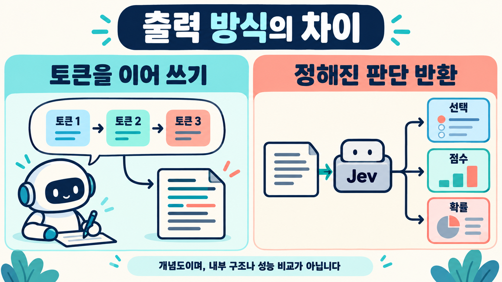
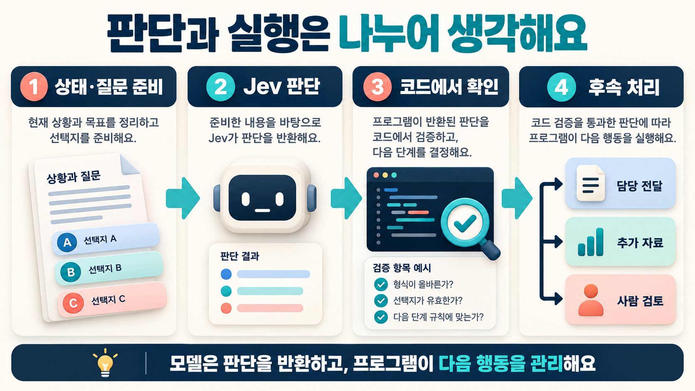

# Jev란 무엇일까? — 글을 이어 쓰는 AI에서, 선택을 내리는 AI로


> 작성: 이건규 · 게시: 2026-10-19 · [가짜연구소 원문](https://pseudo-lab.com/blog/5066d147-dc2a-4f5f-98db-766a3cdf80c4)

AI가 모든 일을 긴 문장으로 답해야 할까요?

어떤 작업에는 설명이 필요하지만, 어떤 작업에는 **‘어느 담당에게 보낼지’, ‘어떤 항목에 속하는지’, ‘추가 확인이 필요한지’** 같은 작은 판단이 필요합니다.

이번에는 TypeSafe의 **Jev**를 출발점으로, 출력 방식·실행 최적화·실제 활용을 나누어 살펴봅니다. 개념 설명에 **Visual Jev 논문**, **Jev in the Wild 논문**, **Paper Compute 해설**을 더했습니다.

## 먼저 세 자료의 역할을 구분해요

| 자료 | 읽는 관점 |
| --- | --- |
| [Visual Jev · Yu·Yao, 2026](https://arxiv.org/abs/2609.25845) | 시각 판단 연구 시스템의 방법·실험 |
| [Jev in the Wild · Ling 외, 2026](https://arxiv.org/abs/2609.30216) | 공개 프로젝트의 사용 양상 |
| [Paper Compute · Jev 해설](https://papercompute.com/concepts/jev/) | 판단 모델과 게이트웨이를 구분하는 해설 |

상용 Jev, 별도 연구 시스템인 Visual Jev, 활용 생태계 조사는 **서로 다른 근거**입니다. 논문 두 편은 이 글에서 arXiv v1 프리프린트로 읽었으며, 게재·심사 완료를 확인했다는 뜻은 아닙니다. 질문 형식과 confidence 필드는 TypeSafe 공식 문서로 교차 확인했습니다.

> 자료 확인·개정: **2026-10-19**. 논문 수치는 저자 보고이며 이 글에서 재실행하지 않았습니다. Jev라는 제품, 비자기회귀 출력 개념, Visual Jev의 구현을 구분합니다. 기존 설명용 그림과 JSON은 실제 모델 응답이나 논문 그림이 아닙니다.

## 1. 자기회귀라는 말부터 풀어봅시다

일반적인 자기회귀 텍스트 생성은 **앞서 나온 내용을 조건으로 다음 토큰을 예측하고, 그 결과를 이어서 다시 다음 토큰을 예측하는 방식**입니다. 토큰은 단어와 정확히 같지는 않은 텍스트 처리 단위입니다.

```text
입력 → 첫 토큰 → 다음 토큰 → 다음 토큰 → … → 답변
```

이미 만든 출력이 뒤의 출력에 영향을 줍니다. 그래서 이 설명에서의 핵심은 **출력 생성의 순차적인 의존 관계**입니다. 학습의 모든 계산이 한 토큰씩만 진행된다는 뜻은 아닙니다.

TypeSafe는 Jev를 이와 달리 자유로운 문자열을 이어 쓰는 대신 여러 구조화된 판단을 병렬로 반환하는 모델로 소개합니다. [TypeSafe 공식 출시 설명](https://typesafe.ai/blog/introducing-system-one-models-and-jev)

## 2. 비자기회귀는 무엇인가요?

이 글에서는 **앞서 생성한 출력 토큰을 차례로 다시 먹여 긴 문자열을 완성하는 루프에 의존하지 않는 출력 방식**을 이해하는 데 초점을 맞춥니다.

비자기회귀라고 해서 모든 모델이 같은 구조이거나 모든 일을 한 번에 해결한다는 뜻은 아닙니다. 구체적인 출력 방식과 계산 과정은 모델마다 확인해야 합니다.

Jev의 경우 TypeSafe는 한 요청에서 여러 질문에 대한 확률을 병렬로 출력한다고 설명합니다. 이것을 **프로그램 전체가 한 번에 끝난다**거나 **신경망 내부 계산이 한 단계뿐이다**라는 뜻으로 읽으면 안 됩니다. [공식 병렬 출력 설명](https://typesafe.ai/blog/introducing-system-one-models-and-jev)

```text
자기회귀 텍스트 생성의 개념
입력 → 토큰 → 토큰 → 토큰 → 문장

Jev가 지향하는 판단 인터페이스의 개념
상태 + 정해진 질문 → 선택·점수·확률 → 프로그램의 다음 단계
```

이 그림은 인터페이스의 차이를 설명하는 개념도이며 모델 내부 구조를 재현한 도식은 아닙니다.



*그림 1. TypeSafe Jev의 출력 인터페이스를 설명하는 개념도입니다. Visual Jev의 내부 구조나 두 모델의 속도·정확도 비교를 나타내지 않습니다.*

## 3. 그래서 Jev는 무엇인가요?

**Jev는 TypeSafe가 개발한, 소프트웨어가 사용할 구조화된 판단을 반환하는 모델입니다.** 회사는 이 계열을 ‘System One 모델’이라고 부릅니다.

입력에는 판단할 자료인 `state`와 질문의 형식·기준을 제공합니다. 출력은 자유로운 설명문 대신 정해진 형식의 값과 확률 정보로 받습니다. [TypeSafe 공식 소개](https://docs.typesafe.ai/introduction)

여기서 System One은 개발사가 사용하는 명칭입니다. 사람의 인지 과정이 그대로 구현되었다는 과학적 결론으로 받아들일 필요는 없습니다.

| 하고 싶은 일 | 자유로운 글이 필요한가요? | 가능한 설계 |
| --- | --- | --- |
| 보고서 초안 작성 | 필요함 | 텍스트 생성 모델로 작성 |
| 문의 담당 선택 | 선택 결과가 우선 | 정해진 담당 중 선택 |
| 문서 분류 | 범주가 우선 | 분류값과 불확실성 기록 |
| 복잡한 문제 해설 | 설명 과정이 필요함 | 근거 확인과 설명 작성 역할 구성 |

위 표는 용도를 이해하기 위한 설계 예시입니다. 특정 모델이 해당 업무에서 충분한 정확도를 냈다는 실험 결과는 아닙니다.

## 4. 어떤 형태로 물어보나요?

공식 문서는 질문 형식을 다음처럼 구분합니다.

| 질문 종류 | 용도 | 공식 응답의 주요 값 |
| --- | --- | --- |
| Choice | 정해진 선택지 중 고르기 | `choice`, `probabilities`, `confidence` |
| Score | 정의한 수준·평가 기준에서 점수화 | `score`, `probabilities`, `confidence` |
| Noul | 문장이 참인지에 대한 판단 | `noul`: 0–1 값 |

Noul에는 별도 `confidence`가 반환되지 않습니다. 모든 응답이 같은 필드를 가진다고 가정하지 말고 질문 종류별 문서를 확인해야 합니다. [공식 질문 형식 소개](https://docs.typesafe.ai/introduction), [confidence 설명](https://docs.typesafe.ai/confidence)

예를 들어 고객 문의를 담당자에게 보내는 작업이라면 아래처럼 생각할 수 있습니다.

```text
상태:
"결제는 되었는데 청구서를 받지 못했습니다."

질문:
이 문의를 어느 담당에게 보내야 하나요?

선택지:
결제 / 배송 / 반품 / 추가 확인
```

선택지 이름뿐 아니라 각 선택지가 어떤 경우를 뜻하는지도 정의해야 합니다. 분류 범위에 들어오지 않는 입력이 있다면 ‘기타’나 ‘추가 확인’ 경로를 설계합니다. [공식 Choice 안내](https://docs.typesafe.ai/primitives/choice)



*그림 2. 모델 판단 이후의 검증·분기·실제 실행은 주변 프로그램에서 관리하는 설계 예시입니다.*

## 5. JSON으로 받으면 전부 같은 기술인가요?

그렇지는 않습니다. **JSON은 결과를 담는 형식이고, 자기회귀 여부는 출력을 계산하는 방식과 관련된 개념**입니다.

자기회귀 모델도 구조화된 출력이나 문법 제한을 이용해 JSON을 만들 수 있습니다. 따라서 결과가 JSON이라는 사실만으로 비자기회귀 모델이라고 판정할 수 없습니다.

Jev의 특징은 단지 화면에 JSON이 보인다는 것이 아니라, 개발사가 설명하는 **문자열 생성 대신 정해진 판단과 확률을 반환하는 출력 계약**입니다. 공식 API의 JSON 필드와 실제 반환 타입은 문서로 확인합니다. [TypeSafe 출시 설명](https://typesafe.ai/blog/introducing-system-one-models-and-jev), [Choice 응답 구조](https://docs.typesafe.ai/primitives/choice)

## 6. 형식이 맞으면 정답인가요?

**형식이 맞는 것과 판단이 맞는 것은 다릅니다.**

예를 들어 ‘결제·배송·반품’ 중 하나만 출력하도록 제한하면, 존재하지 않는 담당 이름을 쓰는 문제를 줄일 수 있습니다. 그래도 실제로는 결제 문의인데 배송을 선택할 수는 있습니다.

| 확인할 것 | 질문 |
| --- | --- |
| 형식 | 허용된 선택지·타입으로 나왔나요? |
| 판단 | 입력 내용을 올바르게 이해했나요? |
| 선택지 설계 | 정답이 될 수 있는 선택지가 있었나요? |
| 운영 | 불확실할 때 검토로 보낼 수 있나요? |

TypeSafe의 ‘환각이 없다’는 홍보 표현을 **내용상 오답이 절대로 없다**는 뜻으로 옮기면 안 됩니다. 공식 출시 글의 관련 설명은 schema matching과 type-safety에 초점을 둡니다. [공식 타입 안전성 설명](https://typesafe.ai/blog/introducing-system-one-models-and-jev)

## 7. 확률과 confidence는 같은 것인가요?

Choice는 선택지별 `probabilities`와 그 분포에서 계산한 `confidence`를 제공합니다. 두 값은 같은 수치가 아닙니다.

예를 들어 아래는 **공식 Choice 계산식을 설명하기 위해 직접 만든 수치 예시**입니다. 실제 Jev 호출 결과나 전체 API 응답이 아닙니다.

```json
{
  "type": "choice",
  "choice": "billing",
  "probabilities": {
    "billing": 0.8,
    "shipping": 0.1,
    "review": 0.1
  },
  "confidence": 0.7
}
```

세 선택지의 가장 큰 확률이 0.8일 때, 공식 Choice 식에 따르면 confidence는 `(0.8 − 1/3) ÷ (1 − 1/3) = 0.7`입니다. 따라서 confidence 0.7을 ‘선택한 답이 정답일 확률 70%’로 그대로 바꿔 읽으면 안 됩니다. [공식 confidence 계산식](https://docs.typesafe.ai/confidence)

또한 확률 보정(calibration)은 많은 예측을 모았을 때 예측 확률과 실제 빈도가 얼마나 맞는지 보는 개념입니다. 한 번의 답을 보장하는 인증서가 아닙니다. 내 업무 자료에서도 맞는지 확인해야 합니다. [TypeSafe 확률 보정 설명](https://docs.typesafe.ai/introduction/machine-learning-primer)


*그림 3. 공식 Choice 식으로 계산한 설명용 수치이며 실제 응답이 아닙니다. confidence는 정답률과 같지 않습니다.*

## 8. 에이전트·스킬·하네스와 어디서 만나나요?

Jev를 모든 일을 대신하는 작업자보다, 전체 흐름 안의 **좁은 판단 단계**로 생각해볼 수 있습니다.

```text
자료 수집
   ↓
질문과 선택지 정의
   ↓
판단 모델 호출
   ↓
프로그램이 검증·분기
   ├─ 다음 담당에게 전달
   ├─ 자료 추가 요청
   └─ 사람 검토
```

예를 들어 ‘이 요청은 문헌 확인 담당과 계산 확인 담당 중 어디로 보낼까?’라는 분기에 활용하는 설계를 생각할 수 있습니다. 이것은 이 글의 응용 구상이며, 실제로 연결해 성능을 확인한 사례는 아닙니다.

### Paper Compute가 강조하는 지점: 모델과 게이트웨이의 분리

Paper Compute의 해설은 Jev를 라우팅 신호를 제공하는 **부품**으로 설명합니다. 어느 경로로 보낼지의 판단과, 정책 적용·기록·전달·실패 시 대체 처리를 운영하는 시스템을 구분하는 관점입니다. 이 절은 그 해설의 구조적 관점을 소개하며, 성능을 독립 검증한 근거로 사용하지 않습니다. [Paper Compute 해설](https://papercompute.com/concepts/jev/)

```text
요청 → 상태 준비 → 판단 모델 → 정책 확인 → 모델·도구·사람·중단
```

위 흐름은 이 글의 개념 예시입니다. 판단 모델이 호출되었다는 사실과 실제 후속 작업이 수행되었다는 사실을 각각 기록해야 합니다. TypeSafe도 판단을 코드에서 조합하는 방식을 설명합니다. [공식 입력·판단 조합 안내](https://docs.typesafe.ai/introduction)

스킬은 질문을 어떻게 정의하고 결과를 해석할지 정리할 수 있고, 하네스는 호출·버전·입력·응답·후속 행동을 기록할 수 있습니다. 판단 모델이 파일을 직접 옮기거나 승인을 대신하는 것으로 가정하지 말고, 다음 행동은 프로그램에서 별도로 구현합니다.

## 9. 어떤 질문부터 시험하면 좋을까요?

공식 문서는 하나의 질문이 한 가지 범위를 다루도록 좁히고, 복잡한 판단은 요소로 나누어 코드에서 조합하는 방식을 권합니다. [공식 질문 설계 안내](https://docs.typesafe.ai/introduction)

입문 실습에서는 아래처럼 설계해볼 수 있습니다.

| 너무 넓은 질문 | 나누어 확인할 질문의 예 |
| --- | --- |
| 이 논문은 믿을 만한가? | 주장 위치가 있는가? 해당 실행 자료가 있는가? |
| 이 문의를 모두 처리해줘 | 어떤 문의 유형인가? 추가 입력이 필요한가? |
| 이 사람을 채용해야 하나? | 먼저 판단 범위·기준·사람 검토 절차부터 설계 |

질문을 한 요청에 묶는 것과 비용이 고정된다는 것은 다릅니다. 질문을 추가하면 입력 토큰도 늘 수 있습니다. [공식 다중 질문 안내](https://docs.typesafe.ai/primitives/choice)

질문을 나누었다고 서로의 답이 자동으로 연결되지는 않습니다. 앞 결과가 다음 질문에 필요하다면 그 의존 관계를 프로그램에서 처리해야 합니다. 여러 질문을 병렬로 반환받는 것과 전체 추론 흐름을 해결하는 것은 다릅니다.

## 10. Visual Jev 논문: 빨라지는 이유를 나누어 봐요

**Visual Jev는 Qwen3-VL 기반의 별도 연구 시스템**입니다. 상용 Jev의 내부 구조·실측 성능으로 읽지 않습니다. 기본 구성은 추가 학습 후 기존 LM head에서 후보 확률을 읽고, 같은 이미지의 공통 prefix를 재사용하며 질문들을 배치 처리합니다. 별도 typed head는 비교 실험이지 필수 구성은 아닙니다.

| 확인한 결과 | 저자 보고 |
| --- | --- |
| 4개 과업 macro 정확도 | 70.6% → 76.1%; 개선은 학습에 포함된 과업 계열에 집중 |
| 같은 이미지의 질문 32개 | 독립 직렬 대비 8.9배, 재사용 없는 배치 대비 3.4배 |
| 메모리 비용 | 8.40 → 10.10 GiB |

**5.7ms는 독립 요청의 응답 시간이 아닙니다.** 약 182ms인 32개 묶음 시간을 나눈 값이며 네트워크·대기열 등은 제외합니다. 질문 하나에서는 공유 경로가 오히려 느렸습니다.

핵심은 ‘비자기회귀라 빠르다’ 한 문장으로 끝내지 않는 것입니다. 이 실험의 주된 절감은 공통 계산 재사용과 배치에 있었습니다. typed head도 일관된 정확도 우위를 보이지 않았습니다. [Visual Jev v1, §§3–6·한계](https://arxiv.org/html/2609.25845v1)

## 11. Jev in the Wild: 어디에 쓰는지와 얼마나 맞는지는 달라요

이 논문은 **2026-09-22까지의 공개 GitHub 프로젝트 2,170개**를 분석합니다. 자료 검색·포함 판정·용도 분류를 수행한 생태계 조사이며, 모든 프로젝트를 실행해 정확도를 비교한 벤치마크는 아닙니다.

속성 판단·점수화·행동 선택 등 용도가 섞여 있고, 여러 인터페이스를 조합합니다. 프로젝트 확인과 주석에는 AI 에이전트 및 추가 검토가 사용됐습니다. 공개 저장소 검색·분류 결과를 비공개 서비스까지 포함한 전체 도입률로 확장하지 않습니다.

라우팅·인터페이스 에이전트는 프로젝트의 **19.6%**이지만 stars의 **63.0%**를 차지했습니다. 관심의 집중과 프로젝트 수는 다르며, stars가 사용량·정확도·사업 성과를 증명하지는 않습니다. [Jev in the Wild v1, §§2–3](https://arxiv.org/html/2609.30216v1)

이 글에서 얻는 교훈은 인기 사례만 골라 평가하지 말고, 내가 맡길 판단 유형과 운영 환경을 먼저 정하자는 것입니다.

## 12. 도입 전에 무엇을 기록하나요?

아래는 특정 성능을 가정하지 않는 시험 체크리스트입니다.

- 사람이 확인한 사례와 기대 판정을 준비합니다.
- 선택지와 설명, 입력·모델 버전을 보관합니다.
- 형식 오류와 내용 오답을 구분합니다.
- 정확도 개선과 캐시·배치 등 실행 최적화 효과를 분리합니다.
- 단독 요청 지연, 묶음 처리량, 메모리 비용을 각각 봅니다.
- 공개 프로젝트 수·관심 지표와 실제 사용·성능을 구분합니다.
- 정상·모호한 입력·선택지 밖 사례를 섞습니다.
- 확률·confidence가 실제 오답과 어떤 관계가 있는지 확인합니다.
- 보류와 사람 검토를 포함한 전체 처리 비율을 봅니다.
- 실패·재시도·통신·후속 확인까지 포함한 시간과 비용을 기록합니다.

공식 페이지의 속도·비용 배수를 그대로 내 작업의 성능으로 옮기지 않습니다. TypeSafe도 출시 글에서 자사 평가 조건과 편향 가능성을 설명합니다. [공식 평가 조건과 단서](https://typesafe.ai/blog/introducing-system-one-models-and-jev)

## 자주 하는 오해

**“비자기회귀면 긴 보고서도 한 번에 써주나요?”**

비자기회귀라는 이름만으로 출력 능력이 정해지지 않습니다. Jev는 공식적으로 자유로운 글 생성보다 구조화된 판단을 위한 제품으로 소개됩니다. 생성하지 않는다는 API 설명만으로 모델 내부가 모두 새로운 구조라고 추정하지도 않습니다. 같은 판단 인터페이스를 어떤 계산으로 구현하는지는 별도로 확인해야 합니다.

**“작은 모델이나 분류기는 모두 Jev와 같은가요?”**

분류·점수화라는 기능이 겹칠 수 있어도 모델 구조·학습·출력 계약은 따로 봐야 합니다. Jev가 비자기회귀 모델 전체를 대표하는 정의는 아닙니다.

**“System One이면 생각하지 않는 건가요?”**

제품 명칭으로 내부 계산과 능력을 단정할 수 없습니다. 실제 질문과 성능, 확인된 공개 설명을 기준으로 이해하세요.

**“보정된 확률이 있으니 사람 확인이 필요 없나요?”**

적용 자료에서의 정확성·보정과 잘못된 판단의 영향을 함께 확인해야 합니다. 확률과 confidence가 있다는 사실만으로 자동 처리 범위를 확정하지 않습니다.

## 어디서 확인하나요?

- [Visual Jev 논문 · arXiv:2609.25845v1](https://arxiv.org/abs/2609.25845v1)
- [Jev in the Wild 논문 · arXiv:2609.30216v1](https://arxiv.org/abs/2609.30216v1)
- [Paper Compute · Jev와 AI gateway 해설](https://papercompute.com/concepts/jev/)
- [TypeSafe 공식 사이트](https://typesafe.ai/)
- [Jev 공식 소개](https://docs.typesafe.ai/introduction)
- [공식 빠른 시작](https://docs.typesafe.ai/introduction/quickstart)
- [Choice 질문과 응답](https://docs.typesafe.ai/primitives/choice)
- [confidence 설명과 계산식](https://docs.typesafe.ai/confidence)

계정 접근·API 사용 조건과 실제 비용은 공식 콘솔·문서에서 확인하세요. 이름이 비슷한 해설·중계 서비스와 공식 서비스도 구분하면 좋습니다.

**긴 설명이 필요한 일과, 프로그램에 넣을 작은 판단이 필요한 일을 나눠보세요.** Jev를 이해하는 출발점은 ‘기존 AI보다 무조건 우월한가?’보다 ‘내 작업의 어느 판단 단계를 맡길 수 있고 어떻게 검증할까?’입니다.

---

이 글은 지정한 논문 두 편의 v1 본문, Paper Compute 해설, TypeSafe 공식 문서를 읽고 재구성한 교육용 글입니다. Paper Compute의 성능 검증 관련 서술은 문서의 확인 시점에 묶어 읽어야 하며 현재 연구 전체에 대한 선언으로 옮기지 않았습니다. 논문 실험·공개 프로젝트 목록·API를 직접 재현하지 않았습니다. 기존 그림·JSON은 설명용 예시이며, Visual Jev의 결과를 상용 Jev 전체에 일반화하지 않습니다.
